<div align="center">

# 🛍️ 담다몰 (damdamall)

### 담는 재미, 담다몰

Python · Flask로 처음부터 직접 구현한 **풀스택 쇼핑몰 웹 애플리케이션**

<br>


-green?style=flat-square)

</div>

<br>

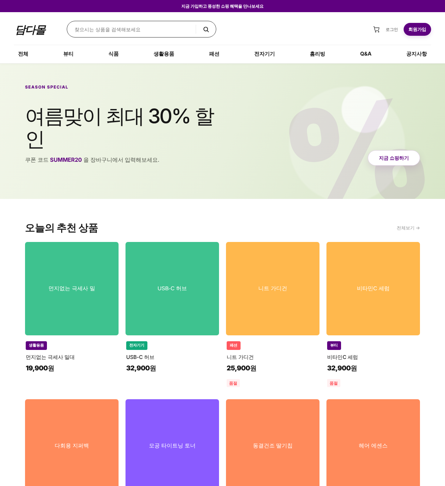

<br>

> [!WARNING]
> 이 프로젝트는 **웹 보안 학습을 위해 만들어진 사이트** 입니다.
> 반드시 **localhost / 격리된 환경에서만** 실행하세요. 공인 IP·클라우드에 절대 노출하지 마세요.

<br>

## 📑 목차

- [프로젝트 소개](#-프로젝트-소개)
- [주요 기능](#-주요-기능)
- [화면 구성](#-화면-구성)
- [기술 스택](#-기술-스택)
- [디렉터리 구조](#-디렉터리-구조)
- [데이터베이스](#-데이터베이스)
- [실행 방법](#-실행-방법)
- [보안 실습](#-보안-실습)
- [배운 점](#-배운-점)

<br>

## 📌 프로젝트 소개

**담다몰(damdamall)** 은 회원 관리부터 상품·장바구니·주문·결제, 커뮤니티, 관리자 기능까지
실제 쇼핑몰에 필요한 전체 흐름을 **Python·Flask로 직접 설계·구현**한 웹 애플리케이션입니다.
단순 기능 구현을 넘어, **웹 애플리케이션의 동작 원리와 보안을 함께 학습**하는 것을 목표로 제작했습니다.

| 구분 | 내용 |
|---|---|
| **프로젝트 유형** | 개인 포트폴리오 |
| **핵심 목표** | 쇼핑몰 전체 기능을 직접 구현하고, 웹 보안을 함께 학습 |
| **규모** | 화면 템플릿 30+ · DB 테이블 13개 |

<br>

## ✨ 주요 기능

### 🛒 쇼핑
- 상품 목록 (카테고리 필터 · 검색) · 상품 상세
- 장바구니 · 쿠폰 적용 · 포인트
- 주문 / 결제(목업) · 주문 내역 · 거래명세서 발급

### 👤 회원
- 회원가입 · 로그인 · 로그아웃 · 마이페이지
- 프로필·아바타 · 배송지 관리 · 비밀번호 변경/재설정

### 💬 커뮤니티
- 상품 리뷰 (작성 · 삭제 · 신고)
- Q&A 게시판 (글·댓글 · 비밀글 · 신고)
- 공지사항

### 🔑 관리자
- 대시보드 · 회원 / 주문 / 상품 관리 (등록·수정·삭제·재고)
- 신고 관리 · 포인트 조정
- **관리자 자동화 봇** — 백그라운드 스레드로 신고 게시물을 주기적으로 점검

<br>

## 🖼️ 화면 구성

### 🛒 쇼핑
| 상품 목록 | 상품 상세 |
|:---:|:---:|
| 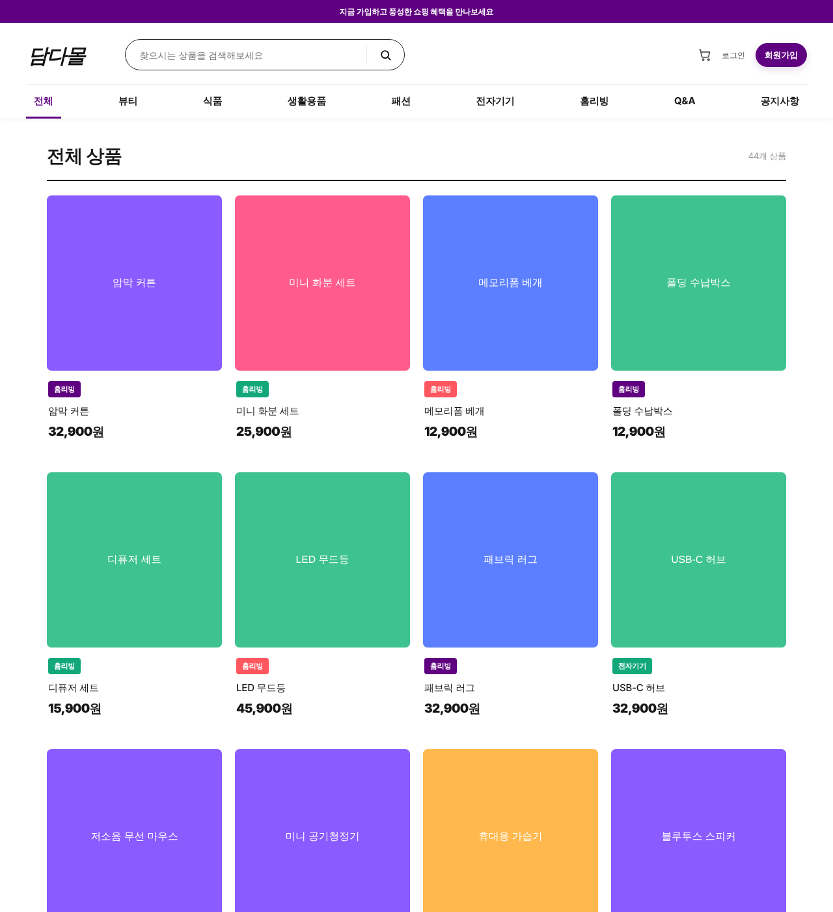 | 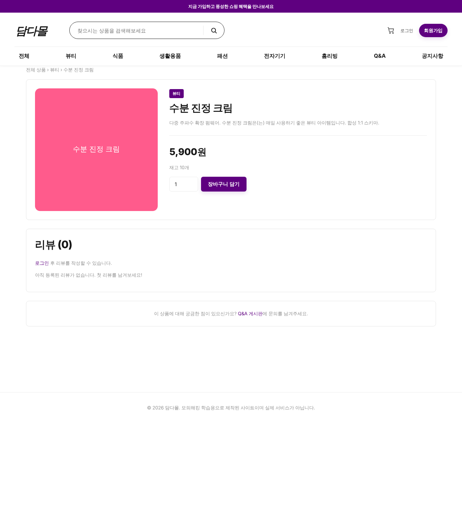 |
| **장바구니** | **공지사항** |
| 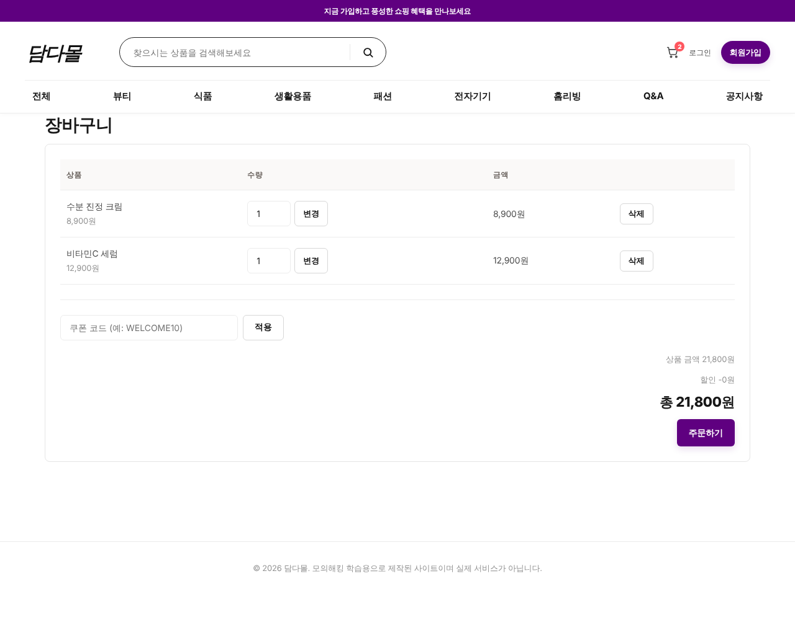 | 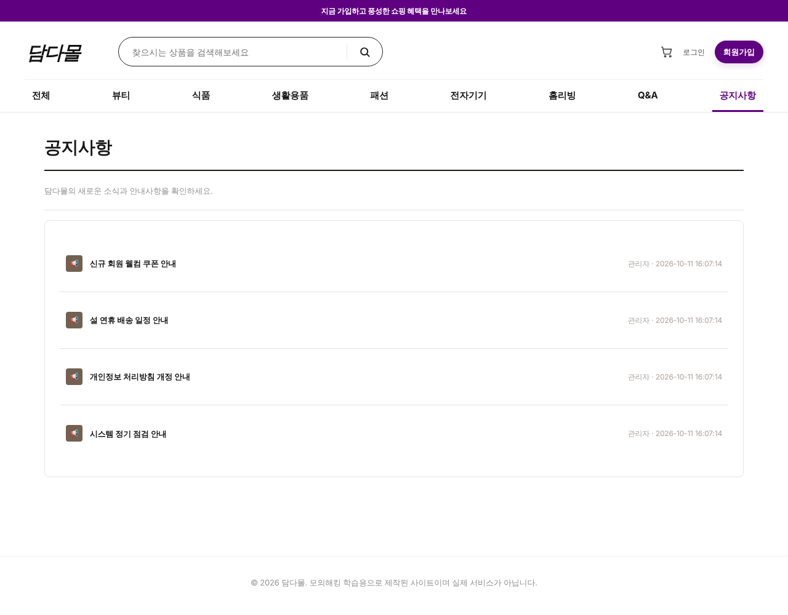 |

### 👤 회원 & 커뮤니티
| 로그인 | 회원가입 |
|:---:|:---:|
| 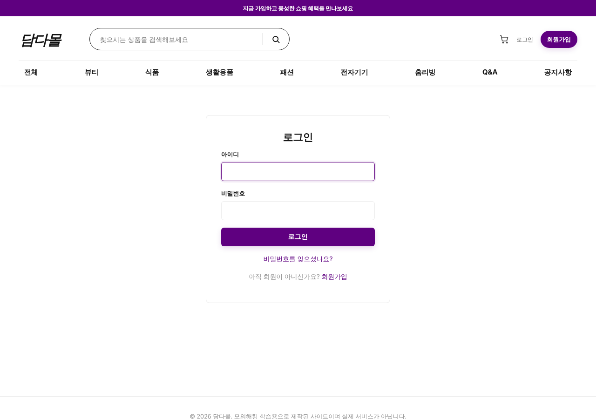 | 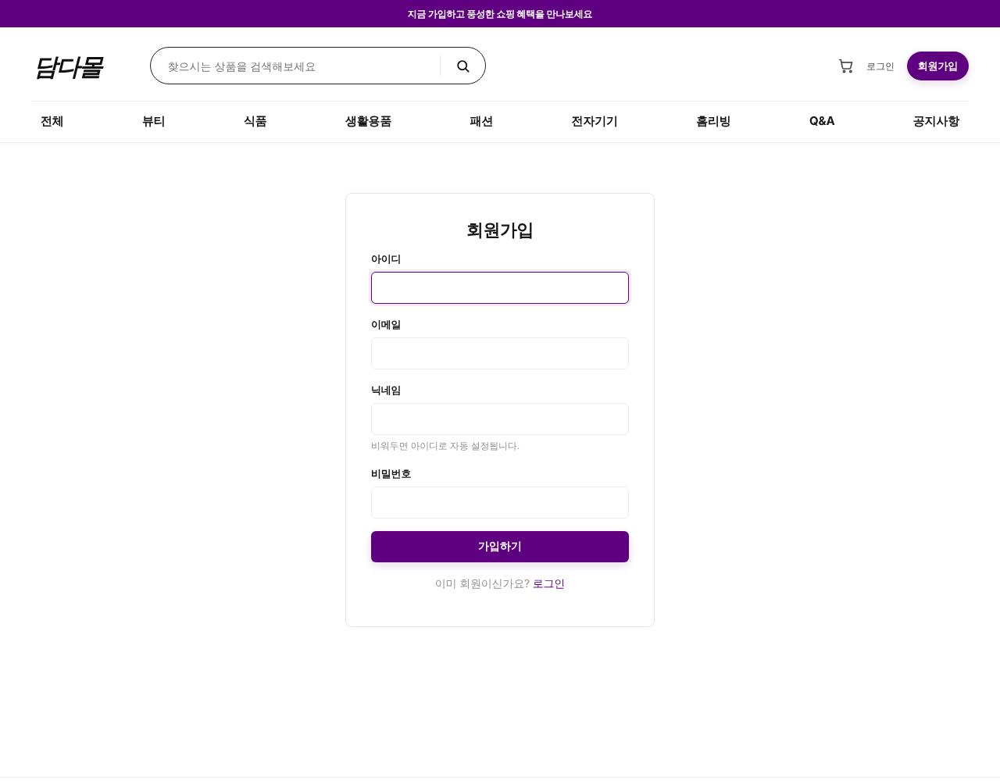 |
| **마이페이지** | **Q&A 게시판** |
| 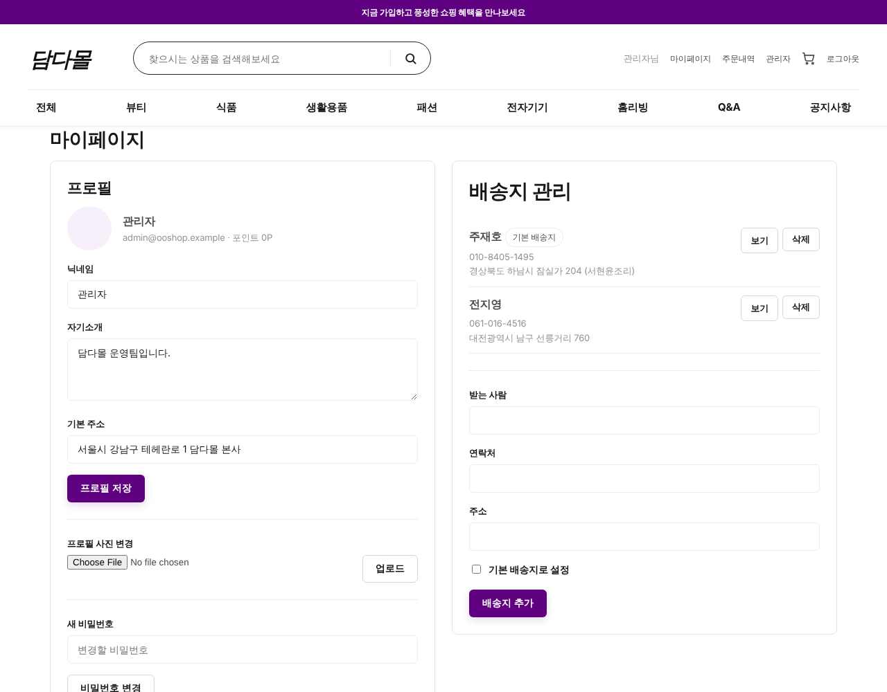 | 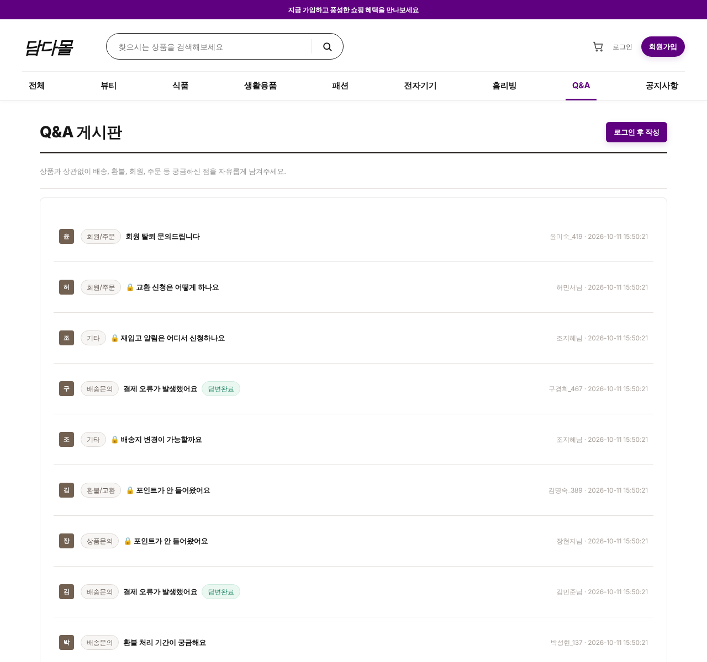 |

### 🔑 관리자
| 관리자 대시보드 | 상품 관리 |
|:---:|:---:|
| 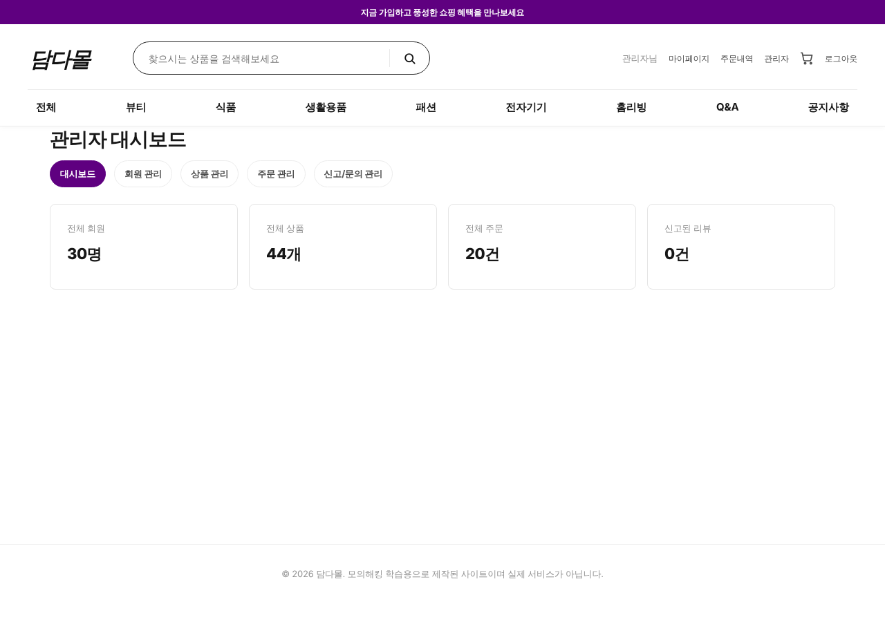 | 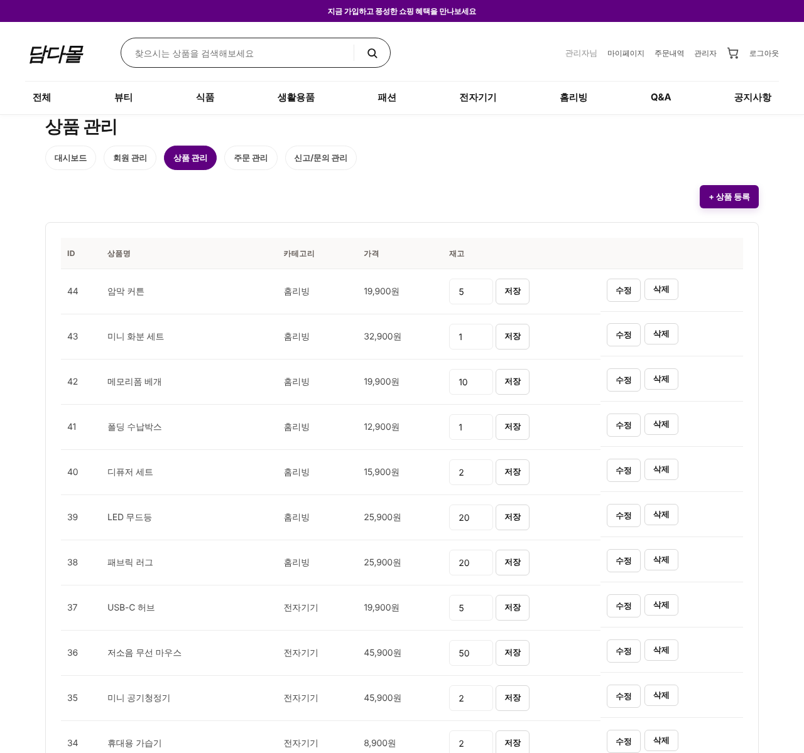 |

<br>

## 🛠️ 기술 스택

<table>
<tr>
<td><b>Backend</b></td>
<td>Python 3 · Flask 3.1</td>
</tr>
<tr>
<td><b>Database</b></td>
<td>SQLite (내장, 설치 불필요)</td>
</tr>
<tr>
<td><b>Template</b></td>
<td>Jinja2</td>
</tr>
<tr>
<td><b>Frontend</b></td>
<td>HTML5 · CSS3 (순수 구현, 프레임워크 미사용)</td>
</tr>
<tr>
<td><b>기타</b></td>
<td>Faker (더미 데이터 자동 생성) · requests (관리자 봇)</td>
</tr>
</table>

<br>

## 📂 디렉터리 구조

```
damdamall/
├── 🐍 app.py                 # 메인 애플리케이션 (라우트 전체)
├── 🗄️ db.py                  # DB 연결 · 스키마 초기화
├── 🌱 seed.py                # 더미 데이터 시딩 (Faker ko_KR)
├── 🤖 admin_bot.py           # 관리자 자동화 봇 (백그라운드 스레드)
├── 📋 schema.sql             # DB 테이블 구조 (참고용)
├── 📦 requirements.txt       # 의존성 목록
│
├── 📁 templates/             # 화면 템플릿 (Jinja2)
│   ├── base.html                   # 공통 레이아웃
│   ├── index.html                  # 메인
│   ├── products.html · product_detail.html
│   ├── cart.html · checkout.html · orders.html · order_detail.html
│   ├── login.html · register.html · account.html
│   ├── board_qna_*.html            # Q&A 게시판
│   ├── notice_*.html               # 공지사항
│   ├── errors/                     # 404 · 403 커스텀 페이지
│   └── admin/                      # 관리자 화면
│
└── 📁 static/
    ├── css/style.css               # 디자인 시스템
    └── uploads/                    # 업로드 파일 저장소
```

<br>

## 🗄️ 데이터베이스

- **SQLite** 를 사용하므로 별도 DB 서버 설치가 필요 없습니다.
- 최초 실행 시 `db.py` 가 **13개 테이블을 자동 생성**하고, `seed.py` 가 더미 데이터
  (회원 30명 · 상품 44개 · 리뷰 · Q&A · 주문 등)를 자동으로 채웁니다.
- 전체 테이블·컬럼 구조는 [`schema.sql`](schema.sql) 에 주석과 함께 정리해두었습니다.

<details>
<summary>📋 테이블 목록 (13개)</summary>

| 테이블 | 설명 | 테이블 | 설명 |
|---|---|---|---|
| `users` | 회원 | `notices` | 공지사항 |
| `sessions` | 로그인 세션 | `board_qna` | Q&A 게시글 |
| `reset_tokens` | 비밀번호 재설정 | `board_qna_comments` | Q&A 댓글 |
| `categories` | 상품 카테고리 | `coupons` | 쿠폰 |
| `products` | 상품 | `coupon_usage` | 쿠폰 사용내역 |
| `addresses` | 배송지 | `orders` | 주문 |
| `reviews` | 상품 리뷰 | `order_items` | 주문 상세 |

</details>

<br>

## 🚀 실행 방법

> SQLite 내장이라 DB 설치가 필요 없고, `python app.py` 한 번이면 DB·더미데이터가 자동 세팅됩니다.

```bash
# 1. (권장) 가상환경 생성
python3 -m venv venv
source venv/bin/activate        # Windows: venv\Scripts\activate

# 2. 패키지 설치
pip install -r requirements.txt

# 3. 실행
python app.py
```

실행 후 브라우저에서 **http://127.0.0.1:5000** 접속

- 최초 실행 시 `damdamall.db` 가 자동 생성되고 더미 데이터가 채워집니다.
- 데이터를 새로 랜덤 생성하려면 `damdamall.db` 파일을 삭제하고 다시 실행하세요.

**기본 계정**

| 구분 | 아이디 | 비밀번호 |
|---|---|---|
| 관리자 | `admin` | `admin1234` |

<br>

## 🛡️ 보안 실습

이 프로젝트에는 **웹 보안 학습을 위한 만들어진 사이트** 입니다.

- 진단 기준으로는 **OWASP Top 10**, **KISA 주요정보통신기반시설 웹 점검 항목** 등을 참고했습니다.

> 💡 직접 실습해보고 싶다면, localhost에 띄운 뒤 브라우저 개발자도구·프록시 도구 등으로 각 기능을 하나씩 점검해보세요.

<br>

## 💡 배운 점

- **방어는 공격을 알아야 가능하다** — 직접 만든 코드를 공격자 관점에서 다시 바라보며, 기능이 "동작하는 것"과 "안전하게 동작하는 것"은 다르다는 점을 체감했습니다.
- **보안은 설계 단계부터** — 기능을 완성한 뒤 덧붙이는 것이 아니라, 처음 설계할 때부터 보안을 고려해야 한다는 것을 느꼈습니다.
- **직접 구현하며 원리를 이해** — 세션·인증·결제 흐름·파일 처리 등 각 기능이 내부적으로 어떻게 동작하는지 깊이 이해했습니다.
- **진단 → 기록 → 개선의 반복** — 문제를 찾고, 원인을 분석하고, 개선하는 과정을 체계적으로 수행하며 보안 점검의 전체 흐름을 경험했습니다.

<br>

---

<div align="center">

**담다몰 (damdamall)** · 쇼핑몰 & 웹 보안 실습 포트폴리오

</div>
